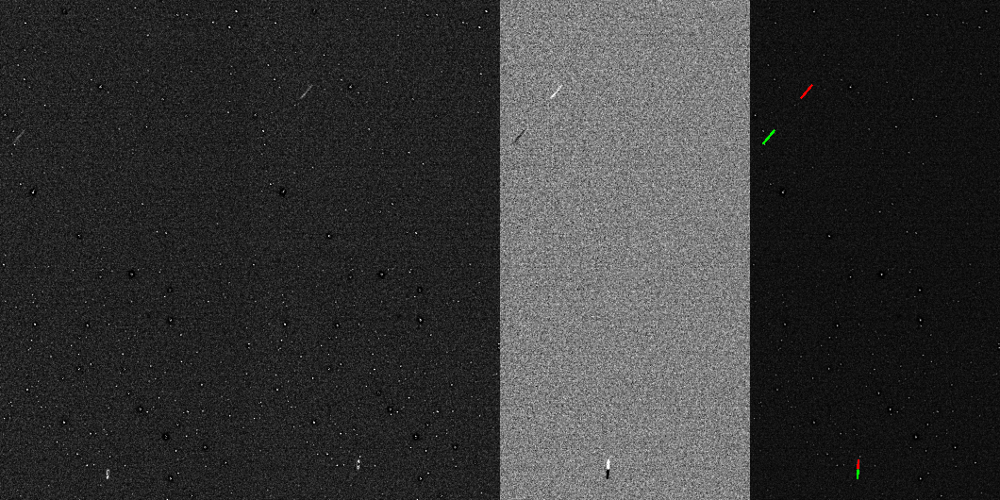
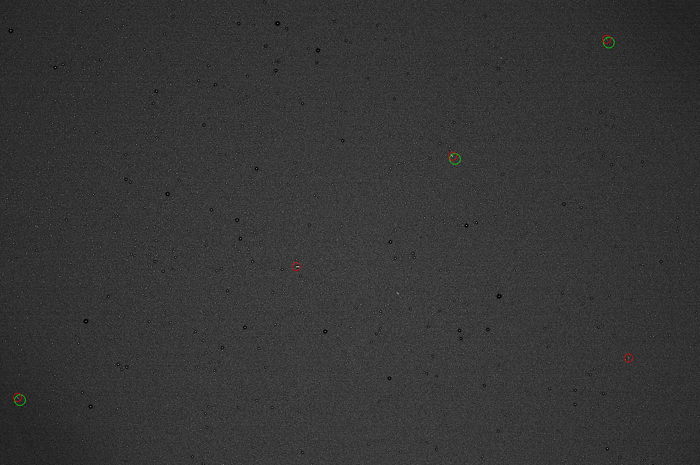

## Moving object detection with the Frigate dataset

Spare-time project using the frigate astrophotography dataset to annotate moving objects in low earth orbit. 
By looking at consecutive frames, detects streaks in the image caused by moving satellites while ignoring distractor signals from things like cosmic rays etc that only appear on single frames.
Base dataset is unlabelled, so in order to get a training set I created a script for generating synthetic objects in real patches of the original data.
This works by placing points along a line defined by some constraints made by examining streaks from the real dataset.
These are then smoothed to create a realistic looking streak in the sampled image. Then, another similar streak is generated further along in the consecutive image, and a label mask is
generated for verification.

### Image generation:

### Preliminary model testing:

Testing on a POC model made mostly using claude shows that a U-Net type architecture is able to accurately detect very faint streaks that would be difficult to spot through manual inspection:

